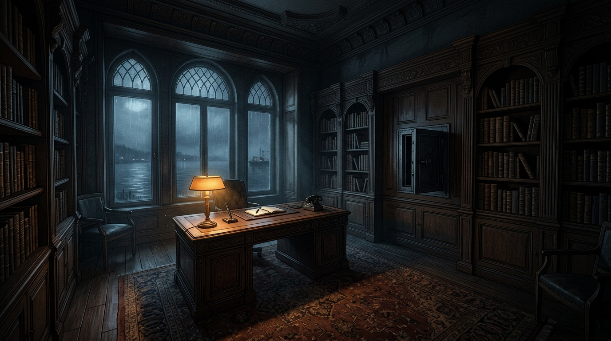

<div align="center">

# DEATH LEAD ACTS

**Prosedürel Adli Dedektif, Delil Tahtası & Hibrit AI Sorgu Simülatörü**

[](https://github.com/murasakimono/death-lead-acts/releases/latest)
[](https://github.com/murasakimono/death-lead-acts/releases/latest)
[](https://tauri.app)



</div>

---

**Death Lead Acts**, her açılışta matematiksel olarak %100 tutarlı ve çözülebilir yeni bir ağır suç dosyası üreten, karanlık Neo-Noir atmosferli bir masaüstü dedektif oyunudur.

Klasik "listeden rastgele katil seç" mantığı yerine; **olay yerini UV 365nm fenerle kendin tarar**, şifreli cihazları ve telsiz kayıtlarını çözer, **kırmızı iplerle çelişkileri bağlar**, şüphelileri canlı poligraf karşısında sorgular ve finalde davayı **4 somut kanıtla** mühürlersin.

---

## Öne Çıkan Özellikler

### 1. İnteraktif Neo-Noir Olay Yerleri & UV 365nm Tarama
* **6 farklı atmosferik mekân:** Özel Hastane Cerrahi Blok, Boğaz Malikânesi Kütüphanesi, Grand Pera 14. Kat VIP Süit, Karaköy Yeraltı Kayıt Stüdyosu, Maslak 22. Kat Ar-Ge Kulesi, Özel Yat Ana Kamarası.
* **Canlı Fener + `[U]` UV 365nm Modu:** Çıplak gözle görünmeyen kan sıçrama vektörleri, kimyasal kalıntılar ve sürükleme izleri sadece UV ışık altında parlar.
* Tek tıkla **Sahne Görünümü** ve **Mimari Kroki** arası geçiş.

### 2. 8 Farklı Adli & Dijital Bilişim Laboratuvarı
| Laboratuvar | Ne Yaparsın? |
|---|---|
| **Kilitli Telefon** | Olay yerindeki ipuçlarından 4 haneli PIN'i çıkarıp silinmiş mesajları kurtar. |
| **HTS Baz Üçgenleme** | 3 baz istasyonu çemberinin kesişimini radar üzerinde kilitleyip alibiyi çökert. |
| **Adli Tıp Ölüm Saati** | Çekirdek vücut ısısı, rigor/livor ve gecikmeli toksikolojiyle ölüm penceresini hesapla. |
| **Ses & Telsiz Temizleme** | Bandpass frekans ve noise gate kaydırıcılarıyla parazitli gece kaydını deşifre et. |
| **CCTV Kare Analizi** | Zaman çubuğunu ileri-geri sararak koridordaki hareket anomalisini yakala. |
| **Adli Kimya Spektrumu** | Bilinmeyen olay yeri numunesini 6 bantlı spektrometrede referans bileşiklerle eşleştir. |
| **Şifreli Duvar Kasası** | 3 kadranlı mekanik kombinasyonu kırıp gizli ıslak imzalı dosyayı çıkar. |
| **Otopsi Vücut Haritası** | Anatomik diyagram üzerindeki kritik bölgeleri inceleyip adli bulguları topla. |

*(Ayrıca **Kanıt A vs. Kanıt B Karşılaştırma Masası**, **Gece Kronolojisi / Alibi Çakışma Matrisi** ve **Kişisel Dedektif Not Defteri**.)*

### 3. Kırmızı İpli Delil Tahtası
* Şüpheli vesikalıklarını ve keşfettiğin kanıtları masada özgürce diz.
* Kartlar arasında yerçekimiyle sarkan **`ÇELİŞKİ`**, **`BAĞLANTI`** ve **`ALİBİ`** ipleri çek.

### 4. Çift Motorlu Sorgu Odası & Canlı 60 FPS Poligraf
* **Taktiksel Sorgu (Sıfır AI — Her PC'de çalışır):** Şüphelinin ifadesindeki çelişkiye tıkla, `SORGULA (Press)` ile sıkıştır veya elindeki kanıtı masaya çarp. Yanlış kanıt Savcılık İtibarını düşürür; doğru darbede poligraf nabzı fırlar ve gizli sır patlar.
* **Canlı AI Sorgu (Ollama / OpenAI-Uyumlu API):** Lokal Ollama modelinle (örn. `qwen2.5:3b`, `llama3.2`) veya harici API ile şüpheliye serbest Türkçe sorular sor. Rust gerçeklik motoru şüphelinin yalan ve sır kurallarını kilitler — **kanıtı masaya koymadıkça kolay kolay çözülmez.**

### 5. "Herkesin Bir Sırrı Var" & 3 Perde (Act I → II → III)
* Sadece gerçek fail değil; masum şüpheliler de kendi kirli sırları (hırsızlık, yasak ilişki, veri sızdırma) yüzünden yalan söyler.
* **ACT II Twist:** İlk çelişkileri kırdığında gecikmeli laboratuvar raporu düşer ve tablo tersine döner.
* **ACT III — 4 Kilitli Final:** Davayı kapatmak için **Fail + Yöntem/Adli Kanıt + Alibi Çökerten Zaman Delili + Motivasyon** halkalarını eksiksiz kilitlemen gerekir.
* **Seed Paylaşımı (`DLA-XXXXX`):** Aynı Seed kodunu arkadaşına atarak birebir aynı vakayı çözme yarışı yap.
* **3 Zorluk & Dedektif Kariyeri:** `Dedektif`, `Cinayet Büro` ve `Süre Baskısı` modları; rütbe, XP, rozetler ve çözülen dosya arşivi.

---

## İndirme & Kurulum (Windows)

1. [Releases](https://github.com/murasakimono/death-lead-acts/releases/latest) sayfasından **`Death Lead Acts_1.2.0_x64-setup.exe`** (~10.8 MB) dosyasını indir.
2. Kurulumu çalıştır ve doğrudan oyna.
3. *(Opsiyonel — Canlı AI Sorgu için)* Bilgisayarında [Ollama](https://ollama.com) kuruluysa bir model indirip (`ollama pull qwen2.5:3b`) Sorgu Odası'ndan **Canlı AI Sorgu** sekmesine geçmen yeterli.

---

## Kaynaktan Derleme

```bash
npm install
npm run tauri build
```

**Gereksinimler:** Node.js 20+, Rust (`rustup`), Windows WebView2 (Windows 11'de yerleşik).
